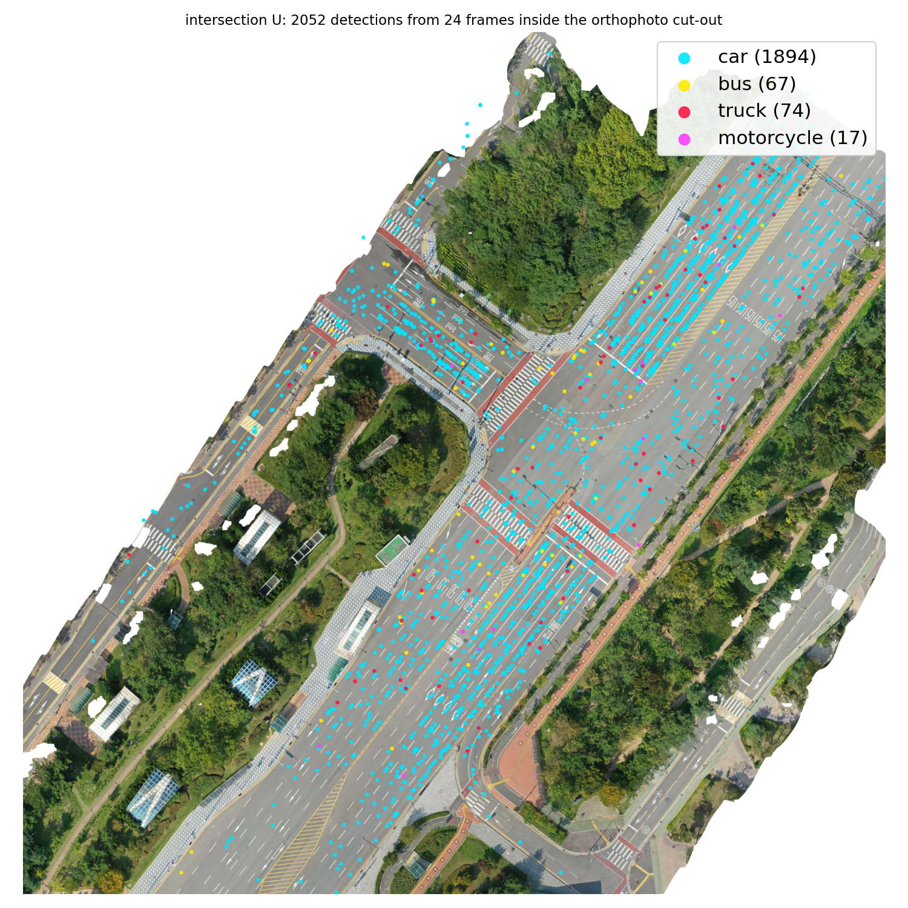

# Vehicle detection and georeferencing from high-altitude drone imagery

This is a learning project with the aim of training a network to correctly detect vehicles from high-altitude drone imagery and map the positions to the vehicles' coordinates.

<p align="center">
  
</p>

Example of the mapping functions. The algorithms detected 2052 vehicles across 24 different frames of the test intersection U. All their positions are marked as dots colored by class in this orthophoto cut-out.

## Pipeline

1. **Data and split**
    I used the Songdo Vision dataset ([Fonod et al., Zenodo](https://doi.org/10.5281/zenodo.13828407)); it is a collection of labeled high-altitude drone images of intersections in Incheon. The dataset contains 1084 frames and the labels cover 4 classes of vehicles: cars, motorcycles, buses and trucks. All 1084 images are different pictures of 20 individual intersections. As such to prevent leakage each image in the dataset got assigned to its intersection using a Scale-Invariant Feature Transform (SIFT) matching against 20 master frames provided by the dataset. 12 intersections got assigned to the train set, 4 to the validation set and 4 to the test set representing approximately a 70/15/15 split.
2. **Tiling and augmentation**
    The 4K images were cut into tiles for training. I chose a tile size of 800px as it is the native input size of torchvision's detector v2 network, which I used as a base for training, with the goal of making the adaptation to the new task as easy as possible for the network. For the overlap I chose 250px which is larger than 99.8% of all vehicles to ensure that almost all vehicles are completely contained in at least one tile. A labeled vehicle box is kept in a tile if at least 30% of its area lands within that tile. For training the data is augmented through multiples of 90 degree rotations and mirroring.
3. **Detector**

    Given limited computational resources (an Apple M5 processor) and a relatively small dataset of 1084 frames, I decided on using a pretrained network as a base. For that I picked the Faster R-CNN detector ([Ren et al. 2015](https://arxiv.org/abs/1506.01497)) with a ResNet-50 FPN v2 network set as the backbone ([He et al. 2016](https://arxiv.org/abs/1512.03385), [Lin et al. 2017](https://arxiv.org/abs/1612.03144), [Li et al. 2021](https://arxiv.org/abs/2111.11429)). It is a machine vision network trained on the common objects in context (COCO) dataset ([Lin et al. 2014](https://arxiv.org/abs/1405.0312)). It consists of 4 subnetworks. The first and main part consists of convolutional layers for feature extraction. The outputs are then inserted into a pyramid network that produces layers at 5 different resolutions, the original goal of which was to ensure scale invariance. The pyramid results are then forwarded to a layer that predicts detection probabilities using anchor boxes in the training input and box sizes and applies the losses (cross-entropy for detections and smoothed L1 for box corrections). The output is then forwarded to one last network to categorize the detections into their classes and apply a second level of box corrections using the class as additional information.

    For training I used a batch size of 2 tiles given limited memory. For the optimizer I used stochastic gradient descent (SGD) with a warm-up followed by a cosine schedule for the step size. I trained for 3 epochs which took about 11h on my M5 mps processor.

4. **Evaluation**
    To obtain the optimal detection probability I maximized the F1 metric on the validation set assigning equal weight to false positives and false negatives obtaining a threshold of approximately 0.8 (the motorcycle optimum was slightly higher at 0.89 but at this stage I used a global value) for all vehicle classes. The quality of the prediction is evaluated using the average precision (integrated precision as a function of recall) at an intersection over union (IoU) threshold of 0.5. The value of 0.5 was chosen to correspond to an offset error in a car's center of about 2m i.e. at least an IoU of 0.5 ensures that the car has at least been assigned to the correct lane.

5. **Full-frame inference**
    
    Subsequently, I implemented full 4K frame inference which first detects vehicles in tiles and subsequently overlaps them removing doubly counted vehicles with a class-aware non-maximum suppression (NMS).
6. **Georeferencing**
    As a final step I mapped the location of vehicles onto their physical coordinates. For that purpose I used the same SIFT algorithms as I used for the master-frame matching and ran a random sample consensus (RANSAC) algorithm on it to obtain a homographic transformation between the frames; this transformation was then chained with the master-frame to orthophoto transformation provided by the dataset to map the coordinates of the center of the vehicle boxes to the orthophoto coordinates. Given that the orthophoto also contained information about the latitude and longitude of the frame I could subsequently map the pixels onto geographic coordinates. However, I noticed that some frame to master-image homographies were incorrect. I therefore used an additional filter that checked the Jacobian determinant of the homography at the center of the frame. As the height of the master-frames is approximately the same as in the dataset the determinant should be approximately area preserving i.e. in the vicinity of 1. If not I skipped the image. In total 12 out of 169 frames were skipped that way.

## Results (test intersections)

| Class | Labeled vehicles | Average Precision at 0.5 full frames | Precision at 0.8 (tiles) | Precision at 0.8 (full frames) | Recall at 0.8 (full frames) |
|---|---|---|---|---|---|
| car | 9,115 | 0.988 | 0.986 | 0.892 | 0.984 |
| bus | 311 | 0.941 | 0.939 | 0.785 | 0.961 |
| truck | 411 | 0.857 | 0.862 | 0.785 | 0.835 |
| motorcycle | 113 | 0.864 | 0.773 | 0.719 | 0.858 |

Test split: 169 frames of intersections E, H, U, K (4,732 tiles). Score threshold 0.8, IoU 0.5.

Georeferencing: 10,473 vehicle positions from 157 of the 169 test frames; 12 frames were skipped because their homography failed the check.

As expected given the large sample size the car identification is the most reliable one at a precision of 98.6% for single tiles. Meanwhile the motorcycles at 77.3% have the lowest precision likely due to both their small sampling number (about 1% of the vehicles) and their small size. All precisions drop significantly when moving from single tile metrics to the full 4K frame. This is likely due to edge vehicles being framed and not correctly dropped if IoU is below 0.5. Some checks and corrections using the validation set should move the two precision values closer together.


## Limitations and next steps

- **Wrong ground-truth labels**: Some of the labels in the dataset are wrongly labeled. This resulted in some detections incorrectly being flagged. Cleaning the label set using e.g. an LLM after a first pass through my network could alleviate this problem.
- **Vehicles cut by tile borders**: As seen in the drop of precision when going from single tile to full image, vehicles at the borders seem to cause problems. An automatic drop of boxes touching the borders (potentially with some conditions to avoid dropping large buses/trucks) could reduce this problem.
- **Errors in matching to the master frame**: Some images are incorrectly mapped to the wrong master-image, breaking the coordinate mapping chain. Here I would introduce the Jacobian determinant as an additional parameter to determine to which master-frame a given image should be mapped.
- **All images are taken at the same fixed altitude**: Should I want to make the network generalizable to more diverse drone footage I would either need a larger dataset or I could augment the data by zooming in and out on the frames.
- **Single training run**: So far the network was only trained once. After implementing a few corrections found in the evaluation the results can be improved through an additional training run.
- **Some dark vehicles and vehicles in the shade were missed:** Augmenting the dataset through brightness variation might help here.
- **Motorcycles have a higher detection threshold:** Since the optimal detection threshold for motorcycles is about 0.89 as compared to 0.8 for the other classes, introducing a class-dependent threshold might improve the result.

## How to run

```bash
python -m venv .venv && source .venv/bin/activate
pip install -r requirements.txt
pip install -e .                          # installs src/dronegeo as a package
python scripts/download_data.py           # data into data/
python scripts/assign_intersections.py    # match every frame to its master frame
python scripts/make_split.py              # split by intersection
python scripts/run_training.py            # about 11 h
python scripts/run_evaluation.py          # tile predictions of the split in configs/config.yaml
python scripts/run_frame_evaluation.py    # full-frame predictions
python scripts/run_georef.py              # GeoJSON
```


## Data and attribution

- **Songdo Vision** (v2): R. Fonod, H. Cho, H. Yeo, N. Geroliminis, Zenodo, [10.5281/zenodo.13828407](https://doi.org/10.5281/zenodo.13828407). CC BY 4.0.
- **Songdo Traffic** (v2): same authors, Zenodo, [10.5281/zenodo.13828383](https://doi.org/10.5281/zenodo.13828383). CC BY 4.0.
- Primary reference: R. Fonod, H. Cho, H. Yeo, N. Geroliminis (2025), *Advanced computer vision for extracting georeferenced vehicle trajectories from drone imagery*, Transportation Research Part C 178, 105205, [10.1016/j.trc.2025.105205](https://doi.org/10.1016/j.trc.2025.105205).

The data is not redistributed in this repository.
